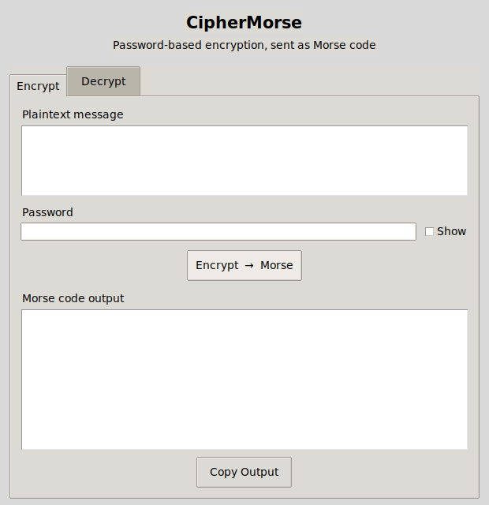

# 🔐 CipherMorse

Encrypt a message with a real, modern cipher — then translate the ciphertext into Morse code. Decrypting reverses the whole trip. A small cross-platform desktop app, built in Python.

[](https://www.python.org/)
[](LICENSE)
[](https://github.com/RajivSarma33/cipher-morse/actions/workflows/tests.yml)



## How it works

**Encrypt:**
`plaintext → PBKDF2-HMAC-SHA256 (600k rounds) → Fernet (AES-128-CBC + HMAC-SHA256) → hex → Morse code`

**Decrypt:** the exact same pipeline in reverse — and it needs the same password.

A random salt is generated per message and travels along with the ciphertext, so encrypting the same text twice never produces the same Morse code twice.

## Features

- 🔑 Real password-based authenticated encryption (Fernet/AES) — not a toy substitution cipher
- 📡 Ciphertext is rendered as genuine International Morse code
- 🖥️ Simple two-tab GUI — Encrypt / Decrypt
- 👁️ Show/hide password toggle, one-click copy of results
- 🧪 Automated tests (crypto round-trip + GUI wiring), run in CI on every push
- 🥚 One small hidden feature, if you go looking for it

## Installation

```bash
git clone https://github.com/YOUR_USERNAME/cipher-morse.git
cd cipher-morse
pip install -r requirements.txt
python cipher_morse_gui.py
```

> `tkinter` ships with most Python installers. On Debian/Ubuntu, if it's missing:
> `sudo apt install python3-tk`

## Usage

1. Open the **Encrypt** tab, type a message and a password, then click **Encrypt → Morse**.
2. Share the Morse output with whoever needs to read it (send the password separately!).
3. They paste it into the **Decrypt** tab with the same password to get the plaintext back.

## Running the tests

```bash
pip install -r requirements.txt
python tests/test_cipher_morse.py
# on Linux with no display attached:
xvfb-run -a python tests/test_cipher_morse.py
```

## Security notes

This is a learning/portfolio project, not a vetted security tool — please don't use it to protect anything that really matters. A few honest caveats:

- Morse code adds no security by itself; it's just an encoding applied *after* encryption.
- The password is never stored, but it's only as strong as what you type — use a long, random one.
- For anything real, reach for an audited, purpose-built tool instead.

## License

Released under the [MIT License](LICENSE).
